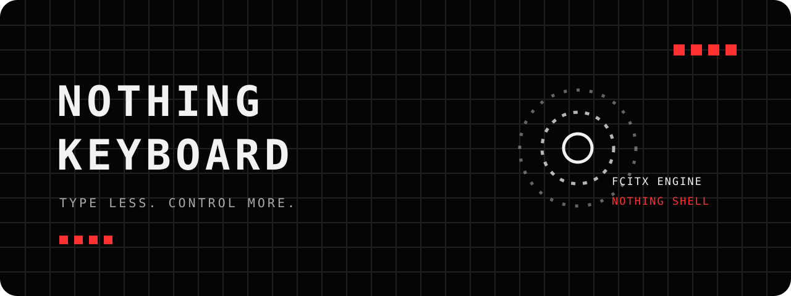

<div align="center">



# Nothing Keyboard

**一款以 Nothing 视觉语言重新设计的 Android 输入法。**<br>
Fcitx 只保留为中文输入引擎边界，其余界面、手势、编辑、导航与动画均由独立系统负责。

[](https://www.android.com/)
[](https://kotlinlang.org/)
[](https://github.com/fcitx/fcitx5)
[](LICENSE)

`BLACK / WHITE / RED` · `DOTO` · `DOT MATRIX MOTION`

</div>

---

## 01 / 设计方向

Nothing Keyboard 不是给原输入法换一套皮肤，而是在稳定输入引擎之外重建一套职责明确的输入系统。

| 原则 | 实现 |
|---|---|
| **信息干净** | 黑色表面、白色主信息、红色只表达状态与反馈 |
| **字体统一** | 英文、数字与功能标签遵循 Doto / 点阵字形规则 |
| **反馈有生命力** | 全界面点阵涟漪、短促反馈、明确的状态变化 |
| **操作少一步** | 空格、删除键与候选栏承担连续手势操作 |
| **系统可维护** | 功能通过数据模型与事件接口沟通，不跨层操纵内部实现 |

## 02 / 已实现

### 输入

- 英文输入
- 简体中文拼音，由 [libime](https://github.com/fcitx/libime) 与 [fcitx5-chinese-addons](https://github.com/fcitx/fcitx5-chinese-addons) 提供引擎能力
- 横向滑动候选栏，无需展开即可连续找词
- 数字、符号、Emoji 与颜文字页面
- 按键上滑输入副字符

### 手势

| 位置 | 手势 | 动作 |
|---|---|---|
| 空格 | 左右滑动 | 移动文本光标 |
| 空格 | 上滑 | 打开快捷编辑工作区 |
| 空格 | 下滑 | 切换输入语言 |
| 删除键 | 左右滑动 | 选择待删除范围，再次点击确认删除 |
| 删除键 | 上滑 | 清空当前输入范围 |
| 删除键 | 下滑 | 撤回最近一次删除 |
| 字母键 | 上滑 | 输入键帽上方的数字或符号 |

### Nothing 界面

- 透明键帽与统一的间距体系
- Doto 字体及专用像素功能图标
- 全输入法表面的点阵圆环涟漪
- 每次随机扩散半径，固定点数与固定点尺寸
- 白色按键预览，红色只用于活动状态和关键提示
- 快捷编辑工作区与 Nothing 风格剪贴板

## 03 / 架构

```text
Android 输入法生命周期
└── Nothing Keyboard 应用外壳
    ├── 输入会话与状态系统
    ├── 编辑命令与撤回系统
    ├── 键盘布局与按键系统
    ├── 候选词与预编辑系统
    ├── 手势识别与反馈系统
    ├── 页面导航与窗口系统
    ├── 字体、字形与颜色系统
    ├── 动画与点阵涟漪系统
    ├── 剪贴板与快捷编辑系统
    └── Fcitx Engine Adapter
        └── Fcitx5 / libime / Chinese Addons
```

详细说明：

- [Nothing Keyboard 架构](docs/NOTHING_KEYBOARD_ARCHITECTURE.md)
- [设计规范](docs/DESIGN_SPEC.md)
- [输入引擎评估](docs/INPUT_ENGINE_EVALUATION.md)
- [旧系统绕过审计](docs/INPUT_SYSTEM_BYPASS_AUDIT.md)

## 04 / 安装与兼容性

- Android 6.0（API 23）及以上
- 普通 Android 手机即可安装，**不需要 Root**
- 当前仍处于持续开发和实机验证阶段，建议先作为测试输入法使用

安装 APK 后：

1. 打开系统的“语言与输入法”设置。
2. 启用 **Nothing Keyboard**。
3. 在输入法选择器中切换到 Nothing Keyboard。

> 输入法可以读取用户输入的内容。请只安装来自本仓库或自己构建的 APK。

## 05 / 构建

### 环境

- Android SDK Platform 36
- Android Build-Tools 36.1.0
- Android NDK 28.0.13004108
- CMake 3.31.6
- KDE extra-cmake-modules
- GNU Gettext 0.20+

### 获取代码

```bash
git clone https://github.com/Unimend/nothing-keyboard.git
cd nothing-keyboard
git submodule update --init --recursive
```

macOS：

```bash
brew install extra-cmake-modules gettext
./gradlew :app:assembleDebug
```

Arch Linux：

```bash
sudo pacman -S extra-cmake-modules
./gradlew :app:assembleDebug
```

Debian / Ubuntu：

```bash
sudo apt install extra-cmake-modules gettext
./gradlew :app:assembleDebug
```

Windows 需要先启用开发者模式与 Git 符号链接支持，再通过 MSYS2 安装构建依赖：

```powershell
git config --global core.symlinks true
```

```bash
pacman -S mingw-w64-ucrt-x86_64-extra-cmake-modules mingw-w64-ucrt-x86_64-gettext
```

## 06 / 项目状态

当前重点是通过真实日常使用继续打磨：

- 手势容错与组合操作
- 候选词长列表体验
- 输入法各页面的视觉一致性
- 动画流畅度与低功耗表现
- 将残余的 Fcitx UI 依赖继续收敛到引擎边界

---

<div align="center">

**NOTHING KEYBOARD**<br>
`ENGINE INSIDE / SYSTEMS OUTSIDE`

基于 Fcitx5 Android 项目演进，遵循 [LGPL-2.1 License](LICENSE)。

</div>
